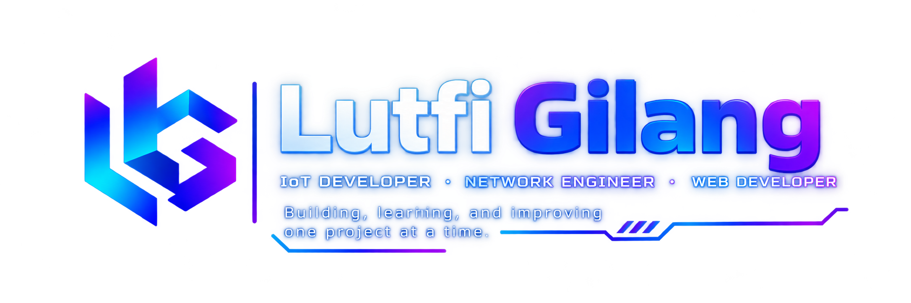

  

 

# MyProfil
# Hey, I'm Lutfi Gilang 👋

### IoT Developer · Network Engineer · Web Developer

I enjoy building practical technology projects, exploring embedded systems, and developing web applications.

- 🔭 Currently working on **LoRa Mesh & IoT systems**
- 🌱 Learning **ESP32, Arduino, networking, and full-stack development**
- 💻 Interested in **IoT, automation, Linux, and open-source**
- 🚀 Goal: Build technology that solves real-world problems

---

### ⚡ Tech Stack

**Languages**
- C/C++ · JavaScript · PHP · Python

**IoT & Embedded Systems**
- Arduino · ESP32 · LoRa · Sensors

**Web Development**
- HTML · CSS · JavaScript · React · Node.js

**Networking & Tools**
- Linux · Git · GitHub · MikroTik

---

### 🚀 Featured Projects

#### 📡 LoRaMesh6
LoRa-based communication and networking project.

#### 🌐 Web Development
Web applications, interactive interfaces, and developer portfolio projects.

#### 🤖 IoT & Smart Devices
Experiments with sensors, microcontrollers, automation, and embedded systems.

---

### 📊 GitHub Activity

---

### 📫 Connect With Me

- GitHub: [@YOUR_USERNAME](https://github.com/YOUR_USERNAME)

---

*Building, learning, and improving one project at a time.* ⚡
